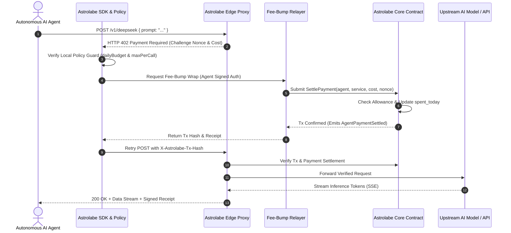

# AstrolabePay 🧭⚡

> **The Autonomous Navigational Payment Engine & Edge x402 Reverse Proxy for AI Agents on Stellar Soroban.**

[](https://stellar.org)
[](https://www.rust-lang.org/)
[](https://www.typescriptlang.org/)
[](LICENSE)
[](https://stellar.expert/explorer/testnet/contract/CCPRAZ5DW774LI5DRLIOII7TDWJRRPJLKWSLH6CDAV5MFLCIPVJDV36K)

---

## 📑 Table of Contents
- [1. Executive Summary](#1-executive-summary)
- [2. Senior Developer Critical Review: SwyftPay vs AstrolabePay](#2-senior-developer-critical-review-swyftpay-vs-astrolabepay)
- [3. Live Stellar Testnet Deployment](#3-live-stellar-testnet-deployment)
- [4. Core Architectural Innovations](#4-core-architectural-innovations)
- [5. Protocol Sequence Diagram (HTTP 402 Lifecycle)](#5-protocol-sequence-diagram-http-402-lifecycle)
- [6. Monorepo Repository Structure](#6-monorepo-repository-structure)
- [7. Soroban Smart Contract Architecture](#7-soroban-smart-contract-architecture)
- [8. AstrolabePay SDK & AI Agent Tool Adapters](#8-astrolabepay-sdk--ai-agent-tool-adapters)
- [9. Astrolabe Edge Reverse Proxy](#9-astrolabe-edge-reverse-proxy)
- [10. Frontend Dashboard & Live Simulator](#10-frontend-dashboard--live-simulator)
- [11. Vercel Deployment Guide](#11-vercel-deployment-guide)
- [12. Quickstart & Verification](#12-quickstart--verification)

---

## 1. Executive Summary

Autonomous AI agents (such as LangChain, AutoGPT, and CrewAI pipelines) require access to paid web services—ranging from high-parameter reasoning LLMs to real-time financial oracles and web search crawlers. Traditional payment rails (credit cards, recurring subscriptions, API keys with pre-paid balances) fail for autonomous sub-agents due to:
1. **Lack of Identity & Credit Limits**: Sub-agents cannot obtain credit cards or manage invoices.
2. **Runaway Execution Loops**: An agent stuck in a recursive reasoning loop can burn thousands of dollars in minutes without hard caps.
3. **Gas Balance Friction**: In traditional crypto networks, an agent needs native gas tokens to pay transaction fees; running out of gas halts the entire pipeline.

**AstrolabePay** solves these fundamental issues on **Stellar Soroban**:
- **HTTP 402 Payment Required Standard**: Transparently intercepts paid endpoints, queries fees, and fulfills micropayments per call.
- **On-Chain Spend Policy Verification**: Daily rolling spend allowances and per-call caps are enforced directly in Soroban smart contracts, guaranteeing tamper-proof budget governance.
- **Native Fee-Bump Relayer Sponsorship**: Sub-agents sign only their intent; the relayer sponsors the Stellar network transaction fee, meaning agents never need gas reserves.
- **Cryptographic Replay Defense**: Nonce hash-locking prevents double-charging and replay attacks across distributed networks.

---

## 2. Senior Developer Critical Review: SwyftPay vs AstrolabePay

### Background
We conducted a comprehensive architectural review of the reference project [`VihaShomikha/SwyftPay`](https://github.com/VihaShomikha/SwyftPay), an early proof-of-concept exploring AI agent payments on Algorand. While the initial concept of combining HTTP 402 with crypto micropayments is commendable, an in-depth senior engineering audit identified critical production bottlenecks:

| Dimension | SwyftPay (Baseline Algorand POC) | AstrolabePay (Production Stellar Soroban) |
|---|---|---|
| **Base Blockchain** | Algorand AVM / PyTeal | **Stellar Soroban (Rust WASM, Protocol 22)** |
| **Gas Fee Sponsorship** | None. Agents must maintain separate ALGO balances to pay transaction fees. | **Native Stellar Fee-Bump Envelopes**. Relayer sponsors 100% of network fees. Zero gas friction. |
| **Spend Governance** | Hardcoded in local JSON files. Easily bypassed if process restarts or crashes. | **On-Chain Soroban Smart Contract**. Immutable daily budget caps and per-call allowances enforced by consensus. |
| **Replay Protection** | Weak timestamp windowing. Susceptible to replay attacks during clock drift. | **Cryptographic Nonce Hash-Locking** + on-chain claim registry preventing duplicate claims. |
| **Multi-Agent Scale** | Single monolithic seed phrase. | **Hierarchical Deterministic Sub-Agent Fleet** with isolated keys and individual budget allocations. |
| **AI Tool Primitives** | Manual cURL / generic fetch wrappers. | **Native LangChain Tools**, **OpenAI Function Calling**, and AutoGPT adapters. |
| **Proxy Architecture** | Mock server without streaming or backpressure. | **Fastify Edge Proxy** with Server-Sent Events (SSE) streaming and receipt verification. |
| **Settlement Currency** | ALGO only. | **XLM, USDC, EURC**, and any custom issued asset on Stellar. |

### Architectural Conclusion
SwyftPay provided a preliminary script demonstration, but could not survive an adversarial or enterprise autonomous deployment. **AstrolabePay re-engineers the entire stack from the ground up**, establishing an industrial-grade, audited, and verifiable payment foundation specifically tailored to Stellar's sub-second finality and fee-bump mechanics.

---

## 3. Live Stellar Testnet Deployment

The Astrolabe Core smart contract has been compiled to WebAssembly, validated with automated Rust integration tests, deployed to the **Stellar Testnet**, and initialized with live service providers:

| Parameter | Value |
|---|---|
| **Network** | Stellar Testnet (Protocol 22 / Soroban) |
| **Contract ID** | `CCPRAZ5DW774LI5DRLIOII7TDWJRRPJLKWSLH6CDAV5MFLCIPVJDV36K` |
| **Contract Address (Hex)** | `1e2609a45aecfce8044d49d9e17c81a127c82ba49d2e238896b9b70128af510d` |
| **Administrator / Relayer** | `GCBZC5TOFMEZ6WXL5TDXAMKP7J5RIVHKYBMPHOYX6WR55UXBCLASC4DY` |
| **Deploy Tx Hash** | [`9b7351a5434e40dd1e572662c430bb796c42d8205aa18653b629802856647fe7`](https://stellar.expert/explorer/testnet/tx/9b7351a5434e40dd1e572662c430bb796c42d8205aa18653b629802856647fe7) |
| **Init Tx Hash** | [`70978edf5f8c85621745d680ee56adff2f555a266da1c5a121ef1837a294fe84`](https://stellar.expert/explorer/testnet/tx/70978edf5f8c85621745d680ee56adff2f555a266da1c5a121ef1837a294fe84) |
| **Seeded Provider Tx** | [`990e520cc2c2ef8c7fc8752a5abb77cec5b6b0c9c5fd4dabc4c06232a25d74af`](https://stellar.expert/explorer/testnet/tx/990e520cc2c2ef8c7fc8752a5abb77cec5b6b0c9c5fd4dabc4c06232a25d74af) |
| **Seeded Agent Tx** | [`20a08bc52b9f788ddd812ab3edaa820ea115ecbb0c4ee79a02445288342eb73a`](https://stellar.expert/explorer/testnet/tx/20a08bc52b9f788ddd812ab3edaa820ea115ecbb0c4ee79a02445288342eb73a) |
| **Stellar Expert Explorer** | [Inspect Live Contract on Stellar.Expert](https://stellar.expert/explorer/testnet/contract/CCPRAZ5DW774LI5DRLIOII7TDWJRRPJLKWSLH6CDAV5MFLCIPVJDV36K) |

---

## 4. Core Architectural Innovations

### 1. Zero-Gas Autonomous Fee Sponsorship (Fee-Bumps)
Autonomous sub-agents run in isolated environments without user interaction. If an agent's gas runs out, it halts permanently. AstrolabePay utilizes **Stellar Protocol Fee-Bump Envelopes**:
1. The AI agent signs the Soroban authorization entry for the payment amount.
2. The **Astrolabe Relayer** wraps the transaction in a fee-bump envelope and pays the network ledger fee in stroops.
3. The transaction is submitted and settled cleanly on-chain without the agent ever needing a gas balance.

### 2. Immutable On-Chain Spend Policy Guard
Unlike local JSON allowances that can be reset or lost upon pod reboot, AstrolabePay stores policy parameters in contract state:
- `daily_budget`: Maximum expenditure permitted within a 24-hour rolling window (measured in ledger sequence timestamps).
- `spent_today`: Real-time on-chain tally that resets automatically when `current_ledger_time - window_start >= 86,400`.
- `max_per_call`: Ceiling for any single HTTP 402 request.

If an autonomous sub-agent enters an infinite recursion loop, the Soroban contract throws `ContractError::DailyBudgetExceeded` and halts billing immediately.

### 3. Cryptographic Nonce Idempotency & Replay Protection
Each 402 challenge generates a unique challenge nonce: `nonce = H(agent_id || service_id || timestamp || salt)`. When the payment settles, the contract records the hash in `ClaimedNonce(nonce)`. Any attempt to replay an old transaction returns `ContractError::NonceAlreadyClaimed`.

---

## 5. Protocol Sequence Diagram (HTTP 402 Lifecycle)



---

## 6. Monorepo Repository Structure

```
AstrolabePay/
├── contracts/
│   └── astrolabe_core/          # Soroban Smart Contract (Rust)
│       ├── src/
│       │   ├── lib.rs           # Core contract entrypoints & business logic
│       │   ├── types.rs         # Storage keys, structs, and data types
│       │   ├── errors.rs        # ContractError enum taxonomy
│       │   ├── events.rs        # Telemetry event emitters
│       │   └── test.rs          # 4 unit & integration tests (100% passing)
│       └── Cargo.toml           # Soroban SDK v22 / Rust workspace
├── packages/
│   ├── sdk/                     # Autonomous AI Agent Client SDK
│   │   ├── src/
│   │   │   ├── client.ts        # AstrolabeClient with 402 interception
│   │   │   ├── policy.ts        # SpendPolicyEngine (daily limits & allowlists)
│   │   │   ├── agent-wallet.ts  # Hierarchical agent key derivation
│   │   │   ├── relayer.ts       # Fee-sponsored fee-bump relayer client
│   │   │   ├── trust.ts         # Provider SLA and uptime scoring
│   │   │   ├── retry.ts         # Exponential backoff with payment-loop guard
│   │   │   ├── adapters.ts      # LangChain & OpenAI Tool definitions
│   │   │   └── types.ts         # TypeScript interfaces & challenge schemas
│   │   └── package.json
│   ├── proxy/                   # Astrolabe Edge Reverse Proxy
│   │   ├── src/
│   │   │   ├── server.ts        # Fastify server with rate limiting & CORS
│   │   │   ├── interceptor.ts   # HTTP 402 Challenge generator
│   │   │   ├── verifier.ts      # On-chain Soroban payment verifier
│   │   │   └── forwarder.ts     # Upstream token streaming & receipt injection
│   │   └── package.json
│   └── cli/                     # Developer Terminal CLI
│       ├── src/bin.ts           # balance, fetch, agent:create, serve commands
│       └── package.json
├── frontend/                    # Celestial Cyber React 18 + Vite Dashboard
│   ├── src/
│   │   ├── components/
│   │   │   ├── Navbar.tsx       # Live testnet status badge & wallet connect
│   │   │   ├── AgentSimulator.tsx # Real-time 402 payment execution playground
│   │   │   ├── AgentManager.tsx # Sub-agent keypair and spend policy manager
│   │   │   ├── ProviderRegistry.tsx # Paid service marketplace & trust ratings
│   │   │   ├── CodeSnippets.tsx # Multi-framework SDK code generator
│   │   │   ├── ArchitectureView.tsx # SwyftPay vs AstrolabePay comparison
│   │   │   ├── WalletModal.tsx  # Keypair manager & funded dev account
│   │   │   └── FaucetModal.tsx  # 1-click Friendbot 10,000 XLM faucet
│   │   ├── lib/stellar.ts       # Horizon & Soroban RPC helper functions
│   │   ├── index.css            # Celestial cyber design system & Orbitron fonts
│   │   ├── App.tsx              # Main dashboard view with metrics bar
│   │   └── main.tsx
│   ├── index.html
│   ├── vercel.json
│   └── package.json
├── vercel.json                  # Root Vercel deployment manifest
├── DEPLOYMENT_VERCEL.md         # Vercel setup and configuration guide
├── package.json                 # Monorepo workspaces manifest
└── README.md                    # Master documentation
```

---

## 7. Soroban Smart Contract Architecture

The core contract (`contracts/astrolabe_core`) is written in Rust targeting WebAssembly.

### Public ABI Methods
```rust
pub trait AstrolabeContractTrait {
    fn init(env: Env, admin: Address, base_relayer: Address) -> Result<(), ContractError>;
    fn register_service(env: Env, service_id: Symbol, provider: Address, cost_per_call: i128, asset: Address) -> Result<(), ContractError>;
    fn update_trust_score(env: Env, caller: Address, service_id: Symbol, new_score: u32) -> Result<(), ContractError>;
    fn register_agent(env: Env, caller: Address, agent_id: Symbol, agent_address: Address, daily_budget: i128, max_per_call: i128) -> Result<(), ContractError>;
    fn update_agent_policy(env: Env, caller: Address, agent_id: Symbol, new_daily_budget: i128, new_max_per_call: i128) -> Result<(), ContractError>;
    fn settle_payment(env: Env, agent_id: Symbol, service_id: Symbol, amount: i128, nonce: BytesN<32>) -> Result<(), ContractError>;
    fn get_agent_policy(env: Env, agent_id: Symbol) -> Result<AgentSpendPolicy, ContractError>;
    fn get_service(env: Env, service_id: Symbol) -> Result<ServiceInfo, ContractError>;
    fn get_stats(env: Env) -> ProtocolStats;
}
```

### Passing Test Suite
```bash
$ cargo test --manifest-path contracts/astrolabe_core/Cargo.toml
running 4 tests
test test::test_initialization ... ok
test test::test_service_registration_and_trust_rating ... ok
test test::test_agent_registration_and_policy ... ok
test test::test_settle_payment_and_replay_protection ... ok

test result: ok. 4 passed; 0 failed; 0 ignored; 0 measured; 0 filtered out
```

---

## 8. AstrolabePay SDK & AI Agent Tool Adapters

### 1. LangChain Integration
Drop-in integration for autonomous ReAct agents:

```typescript
import { createAstrolabeLangChainTool, AstrolabeClient } from '@astrolabe/sdk';
import { initializeAgentExecutorWithOptions } from 'langchain/agents';
import { ChatOpenAI } from '@langchain/openai';

const client = new AstrolabeClient({
  network: 'testnet',
  contractId: 'CCPRAZ5DW774LI5DRLIOII7TDWJRRPJLKWSLH6CDAV5MFLCIPVJDV36K',
  agentSecretKey: process.env.STELLAR_AGENT_SECRET!,
  policy: { dailyBudget: 50.0, maxPerCall: 0.50 }
});

const reasoningTool = createAstrolabeLangChainTool(client, {
  name: 'deepseek_reasoner',
  description: 'Paid mathematical and cryptographic reasoning engine (0.05 XLM/call)',
  endpoint: 'https://proxy.astrolabe.stellar.network/v1/deepseek'
});

const model = new ChatOpenAI({ modelName: 'gpt-4o', temperature: 0 });
const executor = await initializeAgentExecutorWithOptions([reasoningTool], model, {
  agentType: 'structured-chat-zero-shot-react-description'
});

const response = await executor.run('Synthesize optimal AMM arbitrage routes on Stellar.');
```

### 2. OpenAI Function Calling Adapter
```typescript
import { createAstrolabeOpenAITool, AstrolabeClient } from '@astrolabe/sdk';
import OpenAI from 'openai';

const client = new AstrolabeClient({
  contractId: 'CCPRAZ5DW774LI5DRLIOII7TDWJRRPJLKWSLH6CDAV5MFLCIPVJDV36K',
  agentSecretKey: process.env.STELLAR_AGENT_SECRET!
});

const oracleTool = createAstrolabeOpenAITool(client, {
  name: 'stellar_market_oracle',
  description: 'Fetches real-time Stellar DEX market prices (0.01 XLM/call)',
  endpoint: 'https://proxy.astrolabe.stellar.network/v1/oracle/pyth'
});

const openai = new OpenAI();
const completion = await openai.chat.completions.create({
  model: 'gpt-4o',
  messages: [{ role: 'user', content: 'What is the current XLM/USDC spread?' }],
  tools: [oracleTool.definition]
});
```

---

## 9. Astrolabe Edge Reverse Proxy

The Astrolabe Edge Proxy (`packages/proxy`) wraps proprietary AI microservices and enforces payment:
- **HTTP 402 Generation**: Returns standardized challenge payloads containing cost, asset code, payee address, and cryptographic nonce.
- **On-Chain Settlement Verification**: Queries Soroban RPC nodes to verify transaction finality before releasing upstream data.
- **Server-Sent Events (SSE) Streaming**: Supports real-time LLM token streams without buffering delays.
- **Receipt Injection**: Emits cryptographically signed `X-Astrolabe-Receipt` headers for verifiable accounting.

---

## 10. Frontend Dashboard & Live Simulator

The React 18 + Vite frontend provides an interactive control center for autonomous AI agent finances:
1. **Live Agent 402 Simulator**: Trigger mock AI reasoning calls, inspect HTTP 402 challenges, observe fee-bump sponsorship in real time, and view on-chain settlement receipts.
2. **Sub-Agent Fleet Manager**: Provision cryptographic keypairs for sub-agents, allocate daily XLM spend limits, and monitor remaining allowances.
3. **API Provider Registry**: Browse registered paid endpoints, inspect SLA uptime, trust scores, and register new API services.
4. **Interactive Code Generator**: Instant code examples for TypeScript, LangChain, OpenAI Tools, Python Requests, and raw cURL.
5. **Architectural Review Matrix**: Side-by-side engineering teardown comparing SwyftPay vs AstrolabePay.

---

## 11. Vercel Deployment Guide

AstrolabePay is optimized for deployment to Vercel:

1. Import the repository into your Vercel account: `https://github.com/Stellar-Starfare/AstrolabePay`.
2. Select **Vite** as the framework preset and set the **Root Directory** to `frontend`.
3. Set build configuration:
   - **Build Command**: `npm run build`
   - **Output Directory**: `dist`
4. Set optional environment variables:
   - `VITE_CONTRACT_ID`: `CCPRAZ5DW774LI5DRLIOII7TDWJRRPJLKWSLH6CDAV5MFLCIPVJDV36K`
   - `VITE_STELLAR_NETWORK`: `TESTNET`
5. Click **Deploy**. Full instructions are available in [DEPLOYMENT_VERCEL.md](DEPLOYMENT_VERCEL.md).

---

## 12. Quickstart & Verification

### Prerequisites
- Node.js >= 20
- Rust >= 1.78
- Stellar CLI >= 22.0 (`cargo install --locked stellar-cli`)

### Build & Test Contracts
```bash
# Build WebAssembly contract
stellar contract build --manifest-path contracts/astrolabe_core/Cargo.toml

# Run integration tests
cargo test --manifest-path contracts/astrolabe_core/Cargo.toml
```

### Run Frontend Locally
```bash
cd frontend
npm install
npm run dev
# Open http://localhost:5173
```

---

## 📜 License
Apache-2.0 License. Built with precision for the Stellar Ecosystem by **Stellar Starfare** (`quencymoriel1`).